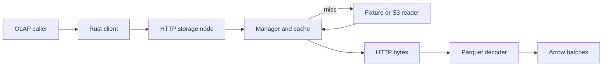
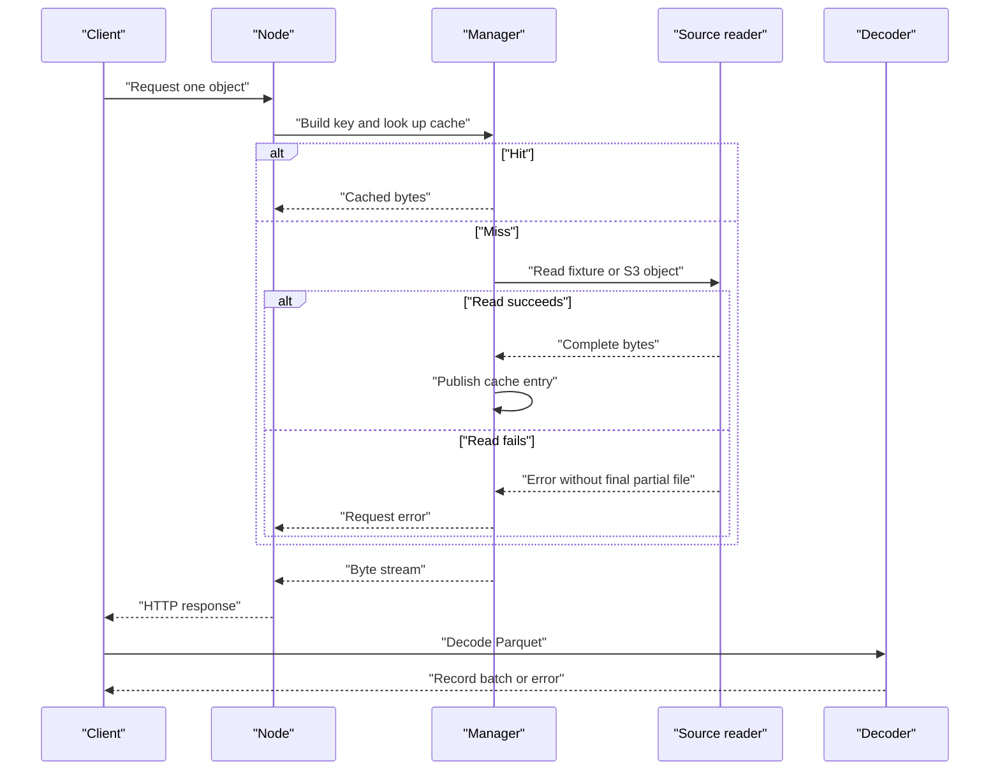

# Parquet I/O service

An asynchronous object-to-Arrow I/O service based on the full MIT-licensed CMU 15-721 Spring 2024 Parpulse capstone. It fetches remote objects through the AWS S3 SDK, caches bytes locally, serves an HTTP stream, and decodes Parquet into Arrow batches for the original OLAP client interface.

The [official showcase](https://15721.courses.cs.cmu.edu/spring2024/project-showcase.html) links [cmu-db/15721-s24-cache1](https://github.com/cmu-db/15721-s24-cache1). This repository retains its complete history, authors and [MIT license](LICENSE), starting at `b4e2bc8f2c2fc3ab7a9b9fa3f8e864e25e9c8c40`. [README.upstream.md](README.upstream.md) preserves the original README. This is an adaptation of that project, not an original-authorship or course-completion claim.

## Contents

- [Run locally](#run-locally)
- [Architecture and execution guide](#architecture-and-execution-guide)
- [Changes in this adaptation](#changes-in-this-adaptation)
- [Checked client](#checked-client)
- [Verification and limits](#verification-and-limits)
- [Reproduce cache and Parquet measurements](#reproduce-cache-and-parquet-measurements)

## Architecture and execution guide

The retained Parpulse workspace supplies cache stores, S3 readers, and the OLAP client contract. This adaptation adds safer cache identity and publication, a checked stream, and local verification. It does not add authentication or durable cache-index recovery. A [cache key](#cache-key) identifies the object; a [record batch](#record-batch) is the decoded output.

The top-level flow connects the client, HTTP node, cache, source reader, and Parquet decoder.



The request sequence distinguishes cache hits from source reads. Failed reads do not publish final partial files; checked decode errors reach the caller.



| Subsystem | Responsibility and owned state | Source |
| --- | --- | --- |
| HTTP node | Parses one-object requests and streams manager responses. | [`server.rs`](storage-node/src/server.rs) |
| Manager | Builds identity, checks cache, coordinates source reads, and inserts completed bytes. | [`storage_manager.rs`](storage-node/src/storage_manager.rs) |
| Readers | Reads fixture paths or remote keys through AWS SDK. | [`storage_reader`](storage-node/src/storage_reader) |
| Cache stores | Holds entries in memory, disk, or SQLite; drop and restart behavior depends on store. | [`cache`](storage-node/src/cache) |
| Client | Requests bytes and decodes them to Arrow batches; checked API surfaces late errors. | [`storage-client`](storage-client/src) |

Execution journey:

1. The caller builds `RequestParams` with source, bucket, and ordered keys.
2. The client requests one object through the HTTP node.
3. The manager makes a [cache key](#cache-key) from source, bucket, count, and framed keys, then checks the store.
4. On a miss, the fixture reader enforces its fixture root or the S3 reader fetches the key. Read failure leaves no final partial object.
5. The manager publishes complete bytes and streams them to the client.
6. The checked client downloads to a temporary file because Parquet metadata is at EOF, then decodes through a bounded channel. Receiver drop stops decode.

| Choice | Current behavior and rationale inferred from code | Alternative and cost to reconsider |
| --- | --- | --- |
| Include source and framed keys in identity | Prevents source collisions and ambiguous concatenation. | Joined strings are simpler but can collide. |
| Publish a complete temporary file | Avoids exposing partial final entries; concurrent disk writers have one winner. | Direct final writes save temporary space but expose partial data after failure. |
| Bound checked batch channel | Backpressures decode and returns late errors; it does not cap object size. | Unbounded delivery can queue decoded data without limit. |
| Download before decoding | Provides Parquet's end metadata to the decoder. | Range or incremental reads reduce temporary storage but require another reader design. |
| Validate for the legacy trait | Preserves its success-only error contract but can hold decoded data proportional to the object. | Changing the trait would break callers. |

These are current tradeoffs, not historical intent. Disk and SQLite stores remove their owned paths on drop and do not rebuild indexes after restart.

<a id="cache-key"></a>

<details><summary>What is a cache key?</summary>

A cache key identifies cached bytes. Here it includes source kind, bucket, object count, and length-delimited names, so fixture and remote objects remain distinct.

</details>

<a id="cache-pin"></a>

<details><summary>What is a cache pin?</summary>

A cache pin keeps an entry available while a consumer reads it. Cancelled disk streams release the pin so they do not retain entries indefinitely.

</details>

<a id="record-batch"></a>

<details><summary>What is a record batch?</summary>

An Arrow record batch is a columnar set of rows with a schema. The shipped fixture decodes to 1,000 rows and 13 columns.

</details>

<a id="cache-publication"></a>

<details><summary>What is cache publication?</summary>

Cache publication makes a complete object visible. The disk path uses a same-directory temporary file before publishing.

</details>

<a id="checked-stream"></a>

<details><summary>What is the checked stream?</summary>

The checked stream yields `Result<RecordBatch>` values, so decode errors can reach the caller after startup. Its bounded channel does not impose a total object-size limit.

</details>

## Run locally

Requires Rust 1.99.1, Python 3.11 or later, and a C/C++ toolchain. Windows needs the MSVC Build Tools. SQLite is built from its bundled source. The application lockfile pins dependencies, including Chrono 0.4.34 for Arrow 50 compatibility.

```powershell
cargo build --locked --workspace --jobs 2
python tools/verify_parpulse.py local
```

The verification command is the self-contained demonstration. It starts the actual service on an unused loopback port, serves the shipped Parquet fixture, proves a cache hit after removing the owned source copy, and runs the actual Rust client. The expected decoded result is 1,000 rows and 13 columns. It also drives missing-source retries, offline regression tests, and the real AWS SDK against an owned local HTTP fixture. It uses dummy fixture credentials and makes no AWS request.

For an interactive local service, run from the storage-node directory so the inherited fixture layout resolves correctly:

```powershell
cd storage-node
cargo run --locked --bin storage_node -- --data-store disk
```

The binary binds `127.0.0.1:3030`. `GET /heartbeat` returns 200. `GET /file?bucket=tests-parquet&keys=userdata1.parquet&is_test=true` serves the local fixture. Without `is_test=true`, the same endpoint reads one exact object key through the S3 SDK's normal credential and region configuration. The HTTP endpoint accepts one object, not a comma-separated object list. The lower-level S3 reader supports ordered multi-object streams.

Use only empty, disposable cache paths. The inherited disk and SQLite stores delete their cache paths on drop. They do not reconstruct cache indexes after restart. This service has no authentication and is not a public deployment configuration.

## Changes in this adaptation

- Cache identity hashes the source kind, bucket, object count and length-delimited keys. Delimiter collisions, mock/remote collisions and request-derived cache filenames are eliminated.
- Disk publication writes an owned same-directory temporary file, flushes it and publishes without replacing an existing winner. A failed source leaves no partial final object; concurrent publication has one winner. Replacement writes truncate an old tail.
- Cancelled disk streams stop sending and release their cache pin. Stream errors terminate after one error. S3 failures no longer poll a completed SDK future again.
- Local fixture access resolves canonical paths inside the shipped Parquet or text fixture directories. Traversal to project source is rejected, and failed source initialization clears pending-cache state.
- The client adds `request_object_checked(RequestParams)`, returning a bounded `Receiver<Result<RecordBatch>>`. Decoder failures reach the consumer; dropping the receiver stops decoding. Blocking Parquet work runs on Tokio's blocking pool.
- The unchanged external `StorageClient` trait cannot express late stream errors. Its adapter validates all batches before returning a successful stream, which uses memory proportional to the decoded object. Its collecting method is implemented; unknown table IDs return errors.
- Normal startup binds loopback. The real-product driver owns and cleans up its processes, sockets and scratch files. Hosted CI uses no cloud credentials or coverage token.

The upstream cache policies, memory/disk and SQLite stores, AWS adapter, request types and OLAP integration remain available. `S3Reader::with_client` allows a configured SDK client, including a local test endpoint, without changing the default AWS constructor.

## Checked client

```rust
use parpulse_client::{client::StorageClientImpl, RequestParams};

let client = StorageClientImpl::new("http://127.0.0.1:3030", "http://127.0.0.1:3031")?;
let request = RequestParams::MockS3(("tests-parquet".into(), vec!["userdata1.parquet".into()]));
let mut batches = client.request_object_checked(request).await?;
while let Some(batch) = batches.recv().await {
    let batch = batch?;
    println!("{} rows", batch.num_rows());
}
```

The object downloads into a temporary file before decoding because Parquet metadata is at the end of the file. The checked API bounds its decoded-batch channel to 32 batches. It does not impose a total object-size limit. The catalog endpoint remains a placeholder and the legacy table API uses the original fixed table map.

## Verification and limits

```powershell
cargo fmt --all -- --check
cargo test --locked --workspace --no-run
cargo clippy --locked --all-targets --all-features
python tools/verify_parpulse.py verification
```

The [verification skill](.agents/skills/verify-parpulse/SKILL.md) and feature map define the real-product checks. Each run needs a new name. Logs, commands, executable hash, HTTP hashes, decoded rows and observed cleanup remain under ignored `.audit/verification/<name>/`. Maintained tooling is under `tools/` and the two Rust examples.

Regression evidence covers ambiguous cache keys, failed downloads, concurrent disk publication, replacement truncation, cancellation, fixture traversal, corrupt Parquet pages, HTTP errors, unknown tables, and SDK HEAD/GET/stream/error behavior on loopback. Existing disk, cache-replacement, SQLite and client tests run without AWS. The rest of the inherited workspace is compiled; its cloud and timing-sensitive tests are not run by this offline driver.

Live AWS compatibility, credentialed access, durable cache restart, crash/power-loss durability and multi-machine OLAP deployment remain unverified. The loopback throughput results below are separate from upstream capstone numbers. The inherited synchronous disk helper and broader cache replacement/concurrency design remain teaching code. Clippy reports inherited warnings visibly. The old public source history includes a coverage-service credential; the active workflow replaces that configuration and never uses it.

## Reproduce cache and Parquet measurements

The [complete single-build baseline](docs/benchmarks/2026-10-22-baseline.md) records 753 trials on a four-logical-CPU AMD EPYC 7763 Ubuntu runner with Rust 1.99.1 release builds. A later [matched comparison](docs/benchmarks/2026-10-22-buffering.md) independently built the frozen baseline and 256 KiB Tokio `BufWriter` candidate on one runner. At 100k rows, 16 columns, eight consumer permits and 50 offers/s, warm-cache throughput rose from 31.93 [31.61, 32.60] to 43.82 [43.57, 44.20] successful requests/s across five trials; successful-response p99 fell from 270.47 [262.83, 272.34] ms to 189.27 [187.71, 208.80] ms. The run recorded zero request errors and checked every decoded value. This is a loopback result for the local cache and temporary-file path, not an AWS or physical-disk throughput claim.

Build `cargo build --release --locked --jobs 2 -p storage-node --example verify_server -p parpulse-client --example benchmark`, then run `python3 tools/benchmark_parpulse.py --output .audit/benchmark/run` on an isolated Linux host. The manual [benchmark workflow](.github/workflows/benchmark.yml) retains raw request CSVs, fixture/binary hashes, commands, resource samples and outcomes.

The driver uses the actual AWS SDK against an owned loopback HTTP object origin with dummy credentials and counted HEAD/GET bytes. It compares a new empty disk cache, a primed cache and a direct-file consumer on identical generated Parquet objects. It sweeps 1k/100k/1m rows, physical row groups, projected columns and concurrency, with five alternating comparisons plus selected sustained offered-rate and stability trials. Every decoded cell must match its deterministic source value. This measures a loopback origin, not AWS latency or bandwidth. It never uses the artificial-delay MockS3 reader for timing.

Projection and row-group selection occur in the benchmark consumer after a full HTTP download. The public checked client still decodes all columns. These runs therefore measure that limitation and cannot claim server pushdown or network-byte savings. Cache-empty means an empty application cache, not an evicted host page cache. Setup smoke timings are not benchmark results.

The [matched buffering workflow](.github/workflows/compare.yml) gates on the offline public-client verifier, then independently builds the frozen baseline and candidate on one host. Run 39740738996 passed the original matrix with all fixture hashes, five reversed-order rounds and the original 60-second stability singles. Both builds used the same server binary, dependencies and compiler. The detailed results and limits are in the [matched comparison report](docs/benchmarks/2026-10-22-buffering.md).
