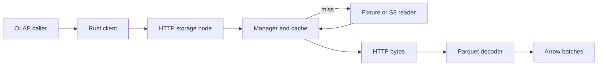
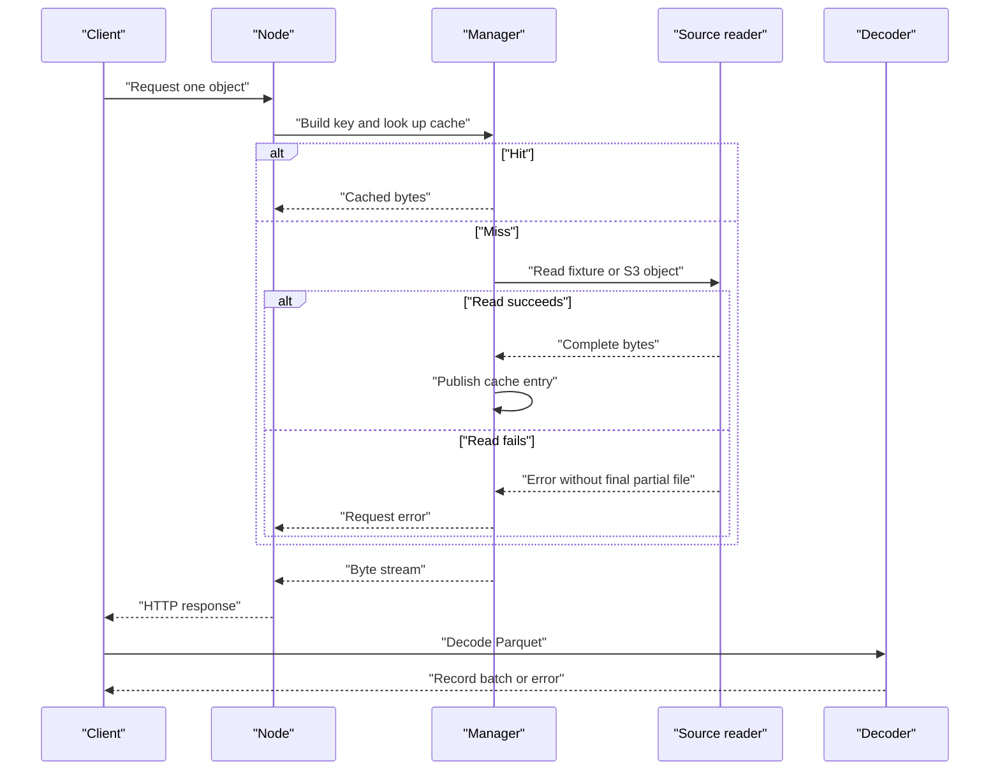

# Parquet I/O service

An asynchronous object-to-Arrow I/O service based on the full MIT-licensed CMU 15-721 Spring 2024 Parpulse capstone. It fetches remote objects through the AWS S3 SDK, caches bytes locally, serves an HTTP stream, and decodes Parquet into Arrow batches for the original OLAP client interface.

The [official showcase](https://15721.courses.cs.cmu.edu/spring2024/project-showcase.html) links [cmu-db/15721-s24-cache1](https://github.com/cmu-db/15721-s24-cache1). This repository retains its complete history, authors and [MIT license](LICENSE), starting at `b4e2bc8f2c2fc3ab7a9b9fa3f8e864e25e9c8c40`. [README.upstream.md](README.upstream.md) preserves the original README. This is an adaptation of that project, not an original-authorship or course-completion claim.

## Contents

- [Run locally](#run-locally)
- [Architecture and execution guide](#architecture-and-execution-guide)
- [Implementation techniques](#implementation-techniques)
- [Changes in this adaptation](#changes-in-this-adaptation)
- [Checked client](#checked-client)
- [Verification and limits](#verification-and-limits)
- [Reproduce cache and Parquet measurements](#reproduce-cache-and-parquet-measurements)

## Architecture and execution guide

The retained Parpulse workspace supplies cache stores, S3 readers, and the OLAP client contract. This adaptation adds safer cache identity and publication, a checked stream, and local verification. It does not add authentication or durable cache-index recovery. A [cache key](#cache-key) identifies the object; a [record batch](#record-batch) is the decoded output.

The top-level flow connects the client, HTTP node, cache, source reader, and Parquet decoder.



The request sequence distinguishes cache hits from source reads. Failed reads do not publish final partial files; checked decode errors reach the caller.



| Subsystem | Responsibility and owned state | Source |
| --- | --- | --- |
| HTTP node | Parses one-object requests and streams manager responses. | [`server.rs`](storage-node/src/server.rs) |
| Manager | Builds identity, checks cache, coordinates source reads, and inserts completed bytes. | [`storage_manager.rs`](storage-node/src/storage_manager.rs) |
| Readers | Reads fixture paths or remote keys through AWS SDK. | [`storage_reader`](storage-node/src/storage_reader) |
| Cache stores | Holds entries in memory, disk, or SQLite; drop and restart behavior depends on store. | [`cache`](storage-node/src/cache) |
| Client | Requests bytes and decodes them to Arrow batches; checked API surfaces late errors. | [`storage-client`](storage-client/src) |

Execution journey:

1. The caller builds `RequestParams` with source, bucket, and ordered keys.
2. The client requests one object through the HTTP node.
3. The manager makes a [cache key](#cache-key) from source, bucket, count, and framed keys, then checks the store.
4. On a miss, the fixture reader enforces its fixture root or the S3 reader fetches the key. Read failure leaves no final partial object.
5. The manager publishes complete bytes and streams them to the client.
6. The checked client downloads to a temporary file because Parquet metadata is at EOF, then decodes through a bounded channel. Receiver drop stops decode.

| Choice | Current behavior and rationale inferred from code | Alternative and cost to reconsider |
| --- | --- | --- |
| Include source and framed keys in identity | Prevents source collisions and ambiguous concatenation. | Joined strings are simpler but can collide. |
| Publish a complete temporary file | Avoids exposing partial final entries; concurrent disk writers have one winner. | Direct final writes save temporary space but expose partial data after failure. |
| Bound checked batch channel | Backpressures decode and returns late errors; it does not cap object size. | Unbounded delivery can queue decoded data without limit. |
| Download before decoding | Provides Parquet's end metadata to the decoder. | Range or incremental reads reduce temporary storage but require another reader design. |
| Validate for the legacy trait | Preserves its success-only error contract but can hold decoded data proportional to the object. | Changing the trait would break callers. |

These are current tradeoffs, not historical intent. Disk and SQLite stores remove their owned paths on drop and do not rebuild indexes after restart.

<a id="cache-key"></a>

<details><summary>What is a cache key?</summary>

A cache key identifies cached bytes. Here it includes source kind, bucket, object count, and length-delimited names, so fixture and remote objects remain distinct.

</details>

<a id="cache-pin"></a>

<details><summary>What is a cache pin?</summary>

A cache pin keeps an entry available while a consumer reads it. Cancelled disk streams release the pin so they do not retain entries indefinitely.

</details>

<a id="record-batch"></a>

<details><summary>What is a record batch?</summary>

An Arrow record batch is a columnar set of rows with a schema. The shipped fixture decodes to 1,000 rows and 13 columns.

</details>

<a id="cache-publication"></a>

<details><summary>What is cache publication?</summary>

Cache publication makes a complete object visible. The disk path uses a same-directory temporary file before publishing.

</details>

<a id="checked-stream"></a>

<details><summary>What is the checked stream?</summary>

The checked stream yields `Result<RecordBatch>` values, so decode errors can reach the caller after startup. Its bounded channel does not impose a total object-size limit.

</details>

## Run locally

Requires Rust 1.99.1, Python 3.11 or later, and a C/C++ toolchain. Windows needs the MSVC Build Tools. SQLite is built from its bundled source. The application lockfile pins dependencies, including Chrono 0.4.34 for Arrow 50 compatibility.

```powershell
cargo build --locked --workspace --jobs 2
python tools/verify_parpulse.py local
```

The verification command is the self-contained demonstration. It starts the actual service on an unused loopback port, serves the shipped Parquet fixture, proves a cache hit after removing the owned source copy, and runs the actual Rust client. The expected decoded result is 1,000 rows and 13 columns. It also drives missing-source retries, offline regression tests, and the real AWS SDK against an owned local HTTP fixture. It uses dummy fixture credentials and makes no AWS request.

For an interactive local service, run from the storage-node directory so the inherited fixture layout resolves correctly:

```powershell
cd storage-node
cargo run --locked --bin storage_node -- --data-store disk
```

The binary binds `127.0.0.1:3030`. `GET /heartbeat` returns 200. `GET /file?bucket=tests-parquet&keys=userdata1.parquet&is_test=true` serves the local fixture. Without `is_test=true`, the same endpoint reads one exact object key through the S3 SDK's normal credential and region configuration. The HTTP endpoint accepts one object, not a comma-separated object list. The lower-level S3 reader supports ordered multi-object streams.

Use only empty, disposable cache paths. The inherited disk and SQLite stores delete their cache paths on drop. They do not reconstruct cache indexes after restart. This service has no authentication and is not a public deployment configuration.

## Changes in this adaptation

- Cache identity hashes the source kind, bucket, object count and length-delimited keys. Delimiter collisions, mock/remote collisions and request-derived cache filenames are eliminated.
- Disk publication writes an owned same-directory temporary file, flushes it and publishes without replacing an existing winner. A failed source leaves no partial final object; concurrent publication has one winner. Replacement writes truncate an old tail.
- Cancelled disk streams stop sending and release their cache pin. Stream errors terminate after one error. S3 failures no longer poll a completed SDK future again.
- Local fixture access resolves canonical paths inside the shipped Parquet or text fixture directories. Traversal to project source is rejected, and failed source initialization clears pending-cache state.
- The client adds `request_object_checked(RequestParams)`, returning a bounded `Receiver<Result<RecordBatch>>`. Decoder failures reach the consumer; dropping the receiver stops decoding. Blocking Parquet work runs on Tokio's blocking pool.
- The unchanged external `StorageClient` trait cannot express late stream errors. Its adapter validates all batches before returning a successful stream, which uses memory proportional to the decoded object. Its collecting method is implemented; unknown table IDs return errors.
- Normal startup binds loopback. The real-product driver owns and cleans up its processes, sockets and scratch files. Hosted CI uses no cloud credentials or coverage token.

The upstream cache policies, memory/disk and SQLite stores, AWS adapter, request types and OLAP integration remain available. `S3Reader::with_client` allows a configured SDK client, including a local test endpoint, without changing the default AWS constructor.

## Checked client

```rust
use parpulse_client::{client::StorageClientImpl, RequestParams};

let client = StorageClientImpl::new("http://127.0.0.1:3030", "http://127.0.0.1:3031")?;
let request = RequestParams::MockS3(("tests-parquet".into(), vec!["userdata1.parquet".into()]));
let mut batches = client.request_object_checked(request).await?;
while let Some(batch) = batches.recv().await {
    let batch = batch?;
    println!("{} rows", batch.num_rows());
}
```

The object downloads into a temporary file before decoding because Parquet metadata is at the end of the file. The checked API bounds its decoded-batch channel to 32 batches. It does not impose a total object-size limit. The catalog endpoint remains a placeholder and the legacy table API uses the original fixed table map.

## Verification and limits

```powershell
cargo fmt --all -- --check
cargo test --locked --workspace --no-run
cargo clippy --locked --all-targets --all-features
python tools/verify_parpulse.py verification
```

The [verification skill](.agents/skills/verify-parpulse/SKILL.md) and feature map define the real-product checks. Each run needs a new name. Logs, commands, executable hash, HTTP hashes, decoded rows and observed cleanup remain under ignored `.audit/verification/<name>/`. Maintained tooling is under `tools/` and the two Rust examples.

Regression evidence covers ambiguous cache keys, failed downloads, concurrent disk publication, replacement truncation, cancellation, fixture traversal, corrupt Parquet pages, HTTP errors, unknown tables, and SDK HEAD/GET/stream/error behavior on loopback. Existing disk, cache-replacement, SQLite and client tests run without AWS. The rest of the inherited workspace is compiled; its cloud and timing-sensitive tests are not run by this offline driver.

Live AWS compatibility, credentialed access, durable cache restart, crash/power-loss durability and multi-machine OLAP deployment remain unverified. The loopback throughput results below are separate from upstream capstone numbers. The inherited synchronous disk helper and broader cache replacement/concurrency design remain teaching code. Clippy reports inherited warnings visibly. The old public source history includes a coverage-service credential; the active workflow replaces that configuration and never uses it.

## Reproduce cache and Parquet measurements

The [complete single-build baseline](docs/benchmarks/2026-10-22-baseline.md) records 753 trials on a four-logical-CPU AMD EPYC 7763 Ubuntu runner with Rust 1.99.1 release builds. A later [matched comparison](docs/benchmarks/2026-10-22-buffering.md) independently built the frozen baseline and 256 KiB Tokio `BufWriter` candidate on one runner. At 100k rows, 16 columns, eight consumer permits and 50 offers/s, warm-cache throughput rose from 31.93 [31.61, 32.60] to 43.82 [43.57, 44.20] successful requests/s across five trials; successful-response p99 fell from 270.47 [262.83, 272.34] ms to 189.27 [187.71, 208.80] ms. The run recorded zero request errors and checked every decoded value. This is a loopback result for the local cache and temporary-file path, not an AWS or physical-disk throughput claim.

Build `cargo build --release --locked --jobs 2 -p storage-node --example verify_server -p parpulse-client --example benchmark`, then run `python3 tools/benchmark_parpulse.py --output .audit/benchmark/run` on an isolated Linux host. The manual [benchmark workflow](.github/workflows/benchmark.yml) retains raw request CSVs, fixture/binary hashes, commands, resource samples and outcomes.

The driver uses the actual AWS SDK against an owned loopback HTTP object origin with dummy credentials and counted HEAD/GET bytes. It compares a new empty disk cache, a primed cache and a direct-file consumer on identical generated Parquet objects. It sweeps 1k/100k/1m rows, physical row groups, projected columns and concurrency, with five alternating comparisons plus selected sustained offered-rate and stability trials. Every decoded cell must match its deterministic source value. This measures a loopback origin, not AWS latency or bandwidth. It never uses the artificial-delay MockS3 reader for timing.

Projection and row-group selection occur in the benchmark consumer after a full HTTP download. The public checked client still decodes all columns. These runs therefore measure that limitation and cannot claim server pushdown or network-byte savings. Cache-empty means an empty application cache, not an evicted host page cache. Setup smoke timings are not benchmark results.

The [matched buffering workflow](.github/workflows/compare.yml) gates on the offline public-client verifier, then independently builds the frozen baseline and candidate on one host. Run 39740738996 passed the original matrix with all fixture hashes, five reversed-order rounds and the original 60-second stability singles. Both builds used the same server binary, dependencies and compiler. The detailed results and limits are in the [matched comparison report](docs/benchmarks/2026-10-22-buffering.md).

## Implementation techniques

This section covers active storage-node cache, source-reader, HTTP, and client paths in this adaptation. The explanations describe current code; design rationale is inferred from its behavior.

| Active subsystem | Technique cards | Source |
| --- | --- | --- |
| Request identity and cache selection | [Source-framed cache identity](#technique-source-framed-cache-key), [Hash-sharded cache selection](#technique-hash-sharded-cache-selection) | [cache key](storage-node/src/cache/data_store_cache/mod.rs#L26), [manager](storage-node/src/storage_manager.rs#L36) |
| Cache fill and memory/disk tiers | [Per-key single-flight fill](#technique-singleflight-cache-fill), [Memory-to-disk admission](#technique-tiered-cache-admission), [Bounded cache streams and pins](#technique-bounded-cache-streams) | [mem-disk cache](storage-node/src/cache/data_store_cache/memdisk/mod.rs#L216), [memory store](storage-node/src/cache/data_store_cache/memdisk/data_store/memory.rs#L30), [disk store](storage-node/src/cache/data_store_cache/memdisk/data_store/disk.rs#L58) |
| Cache replacement and SQLite | [LRU pin-aware eviction](#technique-lru-pinned-eviction), [LRU-K history eviction](#technique-lru-k-history-eviction), [SQLite incremental BLOB reads](#technique-sqlite-blob-streaming) | [LRU](storage-node/src/cache/replacer/lru.rs#L28), [LRU-K](storage-node/src/cache/replacer/lru_k.rs#L52), [SQLite](storage-node/src/cache/data_store_cache/sqlite/mod.rs#L103), [blob reader](storage-node/src/cache/data_store_cache/sqlite/blob.rs#L38) |
| Source reading and disk publication | [Ordered object streaming](#technique-ordered-object-streaming), [Fixture-root validation](#technique-fixture-root-validation), [Complete-file publication](#technique-atomic-complete-file-publication) | [S3 reader](storage-node/src/storage_reader/s3.rs#L101), [fixture reader](storage-node/src/storage_reader/s3_diskmock.rs#L61), [disk writer](storage-node/src/disk/disk_manager.rs#L89) |
| HTTP request handling | [Single-object HTTP query admission](#technique-http-query-single-object-admission) | [route](storage-node/src/server.rs#L28) |
| Client decode and compatibility | [Temporary-file decode and backpressure](#technique-temp-file-parquet-decode-backpressure), [Legacy success-only adapter](#technique-legacy-error-compatible-adapter) | [client](storage-client/src/client.rs#L86) |

<a id="technique-source-framed-cache-key"></a>

<details>
<summary>Source-framed cache identity</summary>

**Mechanism.** `cache_key_from_request` hashes a source-kind byte, the key count, then each bucket and key as a big-endian byte length followed by UTF-8 bytes. The SHA-256 digest is rendered as lowercase hex. For example, `MockS3("tests-parquet", ["a.parquet"])` receives a different identity from `S3` with the same names.

**Example.** A bucket `ab` plus key `c` hashes as framed parts, so it cannot be confused with bucket `a` plus key `bc`.

**Why here.** The manager uses the digest for cache lookup and filenames, so source and component boundaries must remain distinct.

**Tradeoffs.** The digest hides readable request names and adds hashing work. It avoids delimiter ambiguity and request-derived path components.

**Code and ownership.** [`cache_key_from_request`](storage-node/src/cache/data_store_cache/mod.rs#L26). Extension.

</details>

<a id="technique-hash-sharded-cache-selection"></a>

<details>
<summary>Hash-sharded cache selection</summary>

**Mechanism.** `StorageManagerImpl::get_data` hashes the framed key with CRC32 and selects one cache from its vector using the remainder. It checks that shard, fills it on a miss, then opens the cached stream.

**Example.** `index = crc32(cache_key) % caches.len()` chooses the cache handling a request.

**Why here.** The manager shares work across multiple independently synchronized cache instances without a manager-wide lock.

**Tradeoffs.** Every request for one key reaches the same shard, but a hot key remains concentrated there. The implementation assumes the cache vector is nonempty.

**Code and ownership.** [`StorageManagerImpl::get_data`](storage-node/src/storage_manager.rs#L36). Inherited.

</details>

<a id="technique-singleflight-cache-fill"></a>

<details>
<summary>Per-key single-flight cache fill</summary>

**Mechanism.** The mem-disk cache records an `Incompleted` state and a notifier by cache key before reading the source. A concurrent fill increments the waiter count and awaits notification. The completing task stores the size and completed tier before waking waiters. A source error removes the pending state and wakes waiters with a failed fill.

**Example.** Two simultaneous misses for one object share the first source read; the second call waits for its result instead of starting another read.

**Why here.** A slow object fetch can otherwise multiply source traffic for identical concurrent requests.

**Tradeoffs.** Waiters depend on the fill path removing pending state on every error. This coordination is per cache instance and does not coordinate separate processes.

**Code and ownership.** [`MemDiskStoreCache::put_data_to_cache`](storage-node/src/cache/data_store_cache/memdisk/mod.rs#L284). Inherited.

</details>

<a id="technique-tiered-cache-admission"></a>

<details>
<summary>Memory-to-disk cache admission</summary>

**Mechanism.** The cache streams source chunks into memory while tracking total bytes. If the per-file memory threshold is crossed, it removes the partial memory entry, carries the accumulated chunks to disk, then appends the remaining source stream. If the memory replacer cannot admit the completed item, it also falls back to disk.

**Example.** With a 10-byte threshold, chunks of 4, 4, and 4 bytes exceed the limit. The first 12 bytes move to the disk writer before later chunks.

**Why here.** Small objects can be served from memory while larger ones avoid occupying the memory tier.

**Tradeoffs.** A crossing object temporarily retains the accumulated chunks while disk publication proceeds. Disk-only and SQLite configurations use different paths.

**Code and ownership.** [`MemDiskStoreCache::put_data_to_cache`](storage-node/src/cache/data_store_cache/memdisk/mod.rs#L284), [`MemStore::write_data`](storage-node/src/cache/data_store_cache/memdisk/data_store/memory.rs#L59). Inherited.

</details>

<a id="technique-bounded-cache-streams"></a>

<details>
<summary>Bounded cache streams and pin lifetime</summary>

**Mechanism.** Disk and memory readers send chunks through bounded Tokio channels. A disk reader caps its read buffer by the configured maximum. The replacer pins a cached entry while a stream consumes it; the disk task unpins after completion, receiver closure, or read failure. Memory delivery clones the stored chunk references and unpins after sending.

**Example.** The disk reader uses at most `min(file_size, max_disk_reader_buffer_size)` as its read buffer and a 512-item channel.

**Why here.** Bounded channels let downstream reads slow producers and pins prevent eviction during active access.

**Tradeoffs.** The channel capacity is measured in chunks, not bytes. Memory delivery clones its `Vec<Bytes>` for the task, and SQLite uses a separate capacity of five.

**Code and ownership.** [`DiskStore::read_data`](storage-node/src/cache/data_store_cache/memdisk/data_store/disk.rs#L58), [`MemStore::read_data`](storage-node/src/cache/data_store_cache/memdisk/data_store/memory.rs#L30). Mixed.

</details>

<a id="technique-sqlite-blob-streaming"></a>

<details>
<summary>SQLite incremental BLOB reads</summary>

**Mechanism.** SQLite cache entries store bytes in a BLOB and the replacer maps the cache key to its row ID. A reader opens a read-only connection, reads the BLOB in configured chunks, and sends each chunk through a bounded channel.

**Example.** With a 1,024-byte reader buffer, `SqliteBlobReader` advances through the BLOB without first materializing the full object as one byte vector.

**Why here.** The SQLite backend can serve stored objects through the same receiver-based interface as the memory and disk stores.

**Tradeoffs.** The in-memory replacer index is not reconstructed from the database after process restart. The store's drop handler removes its configured database file.

**Code and ownership.** [`SqliteStoreCache::get_data_from_cache`](storage-node/src/cache/data_store_cache/sqlite/mod.rs#L103), [`SqliteBlobReader`](storage-node/src/cache/data_store_cache/sqlite/blob.rs#L38). Inherited.

</details>

<a id="technique-lru-pinned-eviction"></a>

<details>
<summary>LRU eviction with read pins</summary>

**Mechanism.** The LRU replacer keeps entries in access order. A hit moves the entry to the newest end. Admission scans oldest to newest and removes unpinned entries until the new item's size fits. A pinned entry remains in the cache while a reader uses it.

**Example.** If the oldest 9-byte entry is pinned and a new 2-byte item exceeds capacity, insertion can fail even when later entries are smaller.

**Why here.** Capacity is tracked in bytes, and cache readers need a stable entry during streaming.

**Tradeoffs.** Pinning can prevent admission while enough bytes appear occupied. The policy does not evict pinned data to satisfy capacity.

**Code and ownership.** [`LruReplacer::get_value`](storage-node/src/cache/replacer/lru.rs#L28), [`LruReplacer::put_value`](storage-node/src/cache/replacer/lru.rs#L37), and pin methods at [`lru.rs`](storage-node/src/cache/replacer/lru.rs#L89). Inherited.

</details>

<a id="technique-lru-k-history-eviction"></a>

<details>
<summary>LRU-K history-based eviction</summary>

**Mechanism.** The LRU-K replacer records up to K access timestamps per entry. It evicts the unpinned entry with the greatest backward K-distance. Entries with fewer than K recorded accesses receive the farthest-distance priority, with oldest recorded access breaking ties.

**Example.** With K equal to two, a one-hit entry is considered less established than an entry with two recent hits when the cache needs space.

**Why here.** The service exposes LRU-K as an alternative admission policy for its memory, disk, and SQLite replacers.

**Tradeoffs.** Each entry carries access history and the current implementation scans entries to choose a victim. Pinned entries are skipped, and admission can fail if no eligible victim frees enough space.

**Code and ownership.** [`LruKReplacer::evict`](storage-node/src/cache/replacer/lru_k.rs#L52), [`record_access`](storage-node/src/cache/replacer/lru_k.rs#L85). Inherited.

</details>

<a id="technique-ordered-object-streaming"></a>

<details>
<summary>Ordered multi-object source streaming</summary>

**Mechanism.** The S3 reader starts a GET for the current key, yields its body chunks, then advances to the next key after that body ends. The fixture reader follows the same sequential order using disk read streams. Both stop on an error rather than skipping to later objects.

**Example.** A request with keys `["part-a", "part-b"]` emits all chunks from `part-a` before any chunk from `part-b`.

**Why here.** The lower-level source abstraction can represent ordered multi-object reads even though the HTTP endpoint accepts one object.

**Tradeoffs.** Reads are sequential and the byte stream does not mark object boundaries. `read_all` collects each object fully and is documented as unsafe when sizes are unknown.

**Code and ownership.** [`S3ReaderStream::poll_next`](storage-node/src/storage_reader/s3.rs#L101), [`MockS3ReaderStream::poll_next`](storage-node/src/storage_reader/s3_diskmock.rs#L113). Inherited.

</details>

<a id="technique-fixture-root-validation"></a>

<details>
<summary>Canonical fixture-root validation</summary>

**Mechanism.** Before local reads, the mock reader canonicalizes the fixture root and every requested path. It accepts only paths under the Parquet or text fixture directories, then converts the resolved path to UTF-8. Canonicalization resolves traversal and symlink components before the containment check.

**Example.** A key that resolves from `tests/parquet` into a project source directory fails with permission denied.

**Why here.** The test-source adapter turns request names into local file paths, so it enforces a fixture boundary at that conversion point.

**Tradeoffs.** Fixture layout is fixed to the repository's `tests/parquet` and `tests/text` directories. This validation applies to the mock reader, not the remote S3 path.

**Code and ownership.** [`MockS3Reader::validated_paths`](storage-node/src/storage_reader/s3_diskmock.rs#L61). Extension.

</details>

<a id="technique-atomic-complete-file-publication"></a>

<details>
<summary>Complete-file cache publication</summary>

**Mechanism.** The disk manager creates a named temporary file in the destination directory, writes carried memory chunks and remaining stream chunks, flushes and syncs the file, then publishes with `persist_noclobber`. Competing writers cannot replace the first final file. A stream error returns before publication, leaving no final partial entry.

**Example.** Two fills for one key may both create temporary files, but only one can publish the absent destination; the loser receives the publish error.

**Why here.** Readers look up the final cache path, so publishing only after a complete write avoids exposing an in-progress object as a cache hit.

**Tradeoffs.** The write needs temporary disk space alongside the eventual file. `sync_all` asks the operating system to sync file data, but the code does not sync the parent directory.

**Code and ownership.** [`DiskManager::write_bytes_and_stream_to_disk`](storage-node/src/disk/disk_manager.rs#L89). Extension.

</details>

<a id="technique-http-query-single-object-admission"></a>

<details>
<summary>HTTP query parsing and single-object admission</summary>

**Mechanism.** Warp parses the `/file` query into `S3Request`. The route converts its bucket and one `keys` value into an `S3` or fixture `MockS3` request, asks the manager for a receiver, then wraps that receiver as the HTTP body. The route has no request semaphore or explicit resource admission limit.

**Example.** `GET /file?bucket=tests-parquet&keys=userdata1.parquet&is_test=true` becomes one mock-source object request.

**Why here.** The route exposes the manager's object byte stream over HTTP and reports manager errors as status 500.

**Tradeoffs.** The endpoint cannot request multiple object keys, and concurrent requests have no application-level permit cap. Cache/source streams apply their own channel bounds after request acceptance.

**Code and ownership.** [`route`](storage-node/src/server.rs#L28). Inherited.

</details>

<a id="technique-temp-file-parquet-decode-backpressure"></a>

<details>
<summary>Temporary-file Parquet decode with bounded backpressure</summary>

**Mechanism.** The client checks HTTP status, downloads response chunks into a 256 KiB buffered temporary file, flushes it, then decodes Parquet on Tokio's blocking pool. A capacity-32 channel carries `Result<RecordBatch>` values. If the receiver closes, `blocking_send` stops decoding. A decode error is sent as the terminal error item, then the temporary directory is dropped.

**Example.** The checked API returns `Receiver<Result<RecordBatch>>`; callers can observe a page decode failure after earlier batches.

**Why here.** Parquet metadata is at the end of the file, and blocking decode should not occupy an async executor worker.

**Tradeoffs.** The full compressed object occupies temporary disk before decode starts. The channel bounds queued batches, not object bytes or decoded batch size.

**Code and ownership.** [`get_data_from_response_checked`](storage-client/src/client.rs#L104), [`request_object_checked`](storage-client/src/client.rs#L144). Extension.

</details>

<a id="technique-legacy-error-compatible-adapter"></a>

<details>
<summary>Legacy success-only stream adapter</summary>

**Mechanism.** The external `StorageClient` trait returns batches without a per-batch error type. Its adapter first consumes the checked receiver into a `Vec`, propagating any decode error before it returns. Only after all batches validate does it spawn a task that streams successful batches through the legacy receiver. The sync method then collects that receiver into another vector.

**Example.** If the third batch fails to decode, `request_data` returns an error and exposes none of the first two batches as a successful stream.

**Why here.** The adapter preserves the inherited trait signature while the checked API can report errors during consumption.

**Tradeoffs.** Validation consumes memory proportional to all decoded batches, then the receiver delivery can retain that vector until sent. The checked API avoids this all-batches staging.

**Code and ownership.** [`get_data_from_response`](storage-client/src/client.rs#L86), [`StorageClientImpl::request_data_sync`](storage-client/src/client.rs#L256). Extension.

</details>
